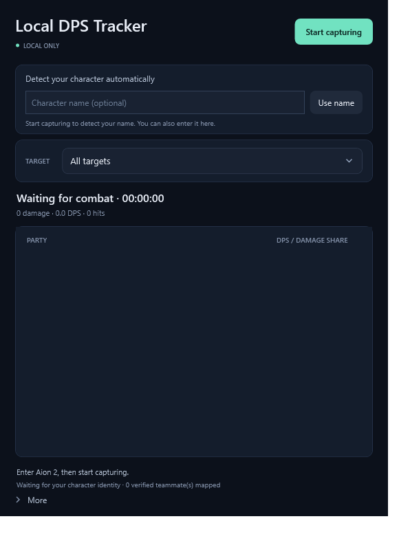

# Local DPS Tracker for Aion 2

[](https://github.com/sccdmaomao/aion2-dps-tracker/actions/workflows/build.yml)

**[Project website](https://sccdmaomao.github.io/aion2-dps-tracker/)** · [Downloads](https://github.com/sccdmaomao/aion2-dps-tracker/releases/latest)

A local-only Windows DPS meter for Aion 2. Passive packet capture, automatic
game connection detection, and party filtering. No account, telemetry, automatic
uploads, or AionFlex installation required.

**[Download the latest Windows release](https://github.com/sccdmaomao/aion2-dps-tracker/releases/latest)**



## Run

1. Install [Microsoft .NET 8 Desktop Runtime for Windows x64](https://dotnet.microsoft.com/en-us/download/dotnet/8.0).
2. Install [Npcap](https://npcap.com/#download). If the app reports a missing
   `wpcap.dll`, enable Npcap's WinPcap API-compatible mode in its installer.
3. Extract the complete release ZIP to a writable folder and open `LocalDpsTracker.exe`.
4. Enter Aion 2 and click the **play icon** beside the encounter timer. Adapter and game ports are automatic.

Your character name is detected when the server sends a local-character identity
message during area loading. If you started capture after entering the world,
keep it running and teleport once. Opening the equipment window
does not resend this identity message. Character detection is automatic; there is no manual name entry.
New identity messages replace stale remembered names. Your name is remembered in
`%LOCALAPPDATA%\LocalDps\track-people.json` across release folders. This remembers
the name only; the current combat entity still needs to be mapped from traffic.

## Features

- All detected party members, including idle members; up to five players total.
- Party-only damage, per-player DPS, damage percentage, and damage-share bars.
- Player labels show `Name (item level / combat power)` from observed identity,
  character-directory and recruiting-room data. Item level often arrives during
  teleport; power can arrive separately. Missing values display `—`; stats stay in memory
  for the current connection and do not establish party membership.
- Column widths and order are locked; the player column adapts to window width.
- Target filtering while capture continues for the whole party.
- Automatic encounter timing and the latest 50 encounters in memory.
- A target is marked **defeated** after a recent positive-to-zero HP transition.
- Icon buttons beside the encounter timer start/stop capture and copy a chart image to the clipboard.
  The copied image includes the current target, encounter totals and every party row.
- Select a target and fight from the target dropdown; repeated fights stay separate. Latest follows new fights automatically.
- Compact combat view shows the whole party, target and timer in a draggable window.
- Compact view stays on top automatically; a left-click percentage dropdown adjusts opacity.
  Mode, opacity, sizes and position are remembered locally.

Damage share is a player's captured damage divided by all captured party damage
in the selected encounter and target. It is not a percentage of enemy maximum HP.

An encounter starts on the first verified party hit and finishes after **15 seconds
without damage**. That ending grace period counts toward elapsed time and DPS.
All targets use the encounter clock, with a one-second minimum for DPS division.
A defeated individual target does not end the whole encounter automatically.
Long boss-phase gaps can split an encounter.
Leaving or changing party keeps already recorded contributions, including player
names, in the chart and copied images. Former members' new hits are excluded.

## Compact combat view

Click the compact-view icon beside the capture/share controls. Compact mode pins
itself above other desktop windows and keeps capturing the same party and targets.
Drag the grip/DPS area to move it. Left-click the percentage dropdown in the
header to select opacity (30–100%); compact view has no pin or right-click menu.
The restore icon returns to the full window and turns always-on-top off. The
target dropdown and capture/share controls work in both views.

The full window has no settings/options menu. The copied chart stays opaque and
readable even when the compact window is small or transparent. Settings and both
window sizes are remembered across restarts. A window saved on a disconnected
monitor is moved back into a visible work area.

Use the game's windowed or borderless mode for desktop-window visibility;
exclusive fullscreen can cover an always-on-top desktop window.

## Target names

Releases include 6,084 English enemy names, embedded in the app and available
offline without extra setup. The catalog is adapted from the MIT-licensed
[taengu/AION2-DPS-Meter catalog](https://github.com/taengu/AION2-DPS-Meter/blob/2fa3c3e186426ff77db81a6608c87030d529ad7c/src/main/resources/i18n/npcs/en.json);
source details and its license are in [NOTICE.md](NOTICE.md).
Keep capture running and teleport once to receive NPC spawn/template mappings.
Unmapped or uncatalogued targets display `Unknown target <entity ID>`; damage and
defeat detection still work. Names may differ from your game's language.

To override or add names, place a UTF-8 `target-names.json` next to `LocalDpsTracker.exe`. It is a
JSON object mapping **NPC template IDs**, not changing combat entity IDs, to
display names. See [the example](examples/target-names.example.json); its IDs and
names are illustrative, not a real game catalog. Use only data you have permission
to use. The app reads the file locally at startup, with a 2 MiB / 20,000-entry limit.
An invalid catalog is ignored and reported in the capture button’s tooltip.

## Privacy

Capture starts only when requested. There are no outbound HTTP clients, accounts,
telemetry endpoints, or automatic uploads. The app does not inject into the game
or read game process memory.

Remembered character: `%LOCALAPPDATA%\LocalDps\track-people.json` (older profiles
beside the executable are read when no saved profile exists). Learned names:
`%LOCALAPPDATA%\LocalDps\known-character-names.json`. Neither file grants party
membership by itself. Window settings:
`%LOCALAPPDATA%\LocalDps\window-preferences.json`. Encounter history stays in memory.

Chart sharing copies an image to the Windows clipboard. The UI has no encounter
export or diagnostic-recording menu. Public source and releases contain no real
player profiles or recordings. Unicode protocol tests use substituted identities.

## Build and test

Windows x64, PowerShell, and the [.NET 8 SDK](https://dotnet.microsoft.com/en-us/download/dotnet/8.0)
are required to build. There are no third-party NuGet dependencies.

```powershell
./scripts/Build.ps1
```

This builds, runs protocol/capture-reassembly/identity/party/encounter tests,
publishes a framework-dependent app, and creates a clean release ZIP under
`artifacts/`. Npcap and a running game are not needed for the offline self-tests.
Npcap is required for live capture.

For a build without packaging:

```powershell
dotnet build src/LocalDps/LocalDps.csproj -c Release
$test = Start-Process ./src/LocalDps/bin/Release/net8.0-windows/LocalDpsTracker.exe `
  -ArgumentList '--self-test' -Wait -PassThru
if ($test.ExitCode -ne 0) { throw 'Self-tests failed' }
```

GitHub Actions builds, runs the offline self-tests, and packages the app on pushes
to main and pull requests. It can also be run manually from the Actions tab. Each
successful run provides a Windows ZIP and SHA-256 checksum as downloadable artifacts.
No live game, Npcap installation, or repository secrets are needed. Maintainers
publish release assets separately on the GitHub Releases page.

## Status and limits

This is a working prototype tested against local recordings, not an independently
verified benchmark of exact in-game damage. Protocol updates can break decoding.
Two-person join/leave layouts and five-person periodic recovery have checks;
unsupported roster layouts fail closed. Mid-instance capture may miss identity
or spawn data. Far-away members' damage is unavailable when the server does not
send it. Pets, relay traffic, and other untested layouts remain provisional.

See [protocol notes](docs/protocol.md), [contributing](CONTRIBUTING.md), and
[data/dependency notices](NOTICE.md). Original source is [MIT licensed](LICENSE).

## Website

The GitHub Pages site is plain HTML/CSS in `docs/site/`. Changes to that folder
are deployed by `.github/workflows/pages.yml`. Only the website directory is
uploaded; source code, local app data, and research files are not part of the site.
